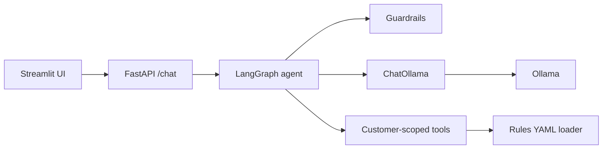

# ShopAssist

ShopAssist is a small synthetic e-commerce support assistant built with FastAPI,
Streamlit, LangChain, LangGraph, and Ollama. Return and refund rules live in
`app/rules/rules.yaml`; the LLM never decides refund eligibility.

## Setup

Requirements: Python 3.12, Git, VS Code, and Ollama.

```powershell
cd "D:\AIML project\shopassist"
Copy-Item .env.example .env
\.venv\Scripts\python.exe -m pip install -r requirements.txt
```

Configure the models in `config.yaml`, then start Ollama and pull them:

```powershell
ollama pull qwen2.5:7b
ollama pull nomic-embed-text
\.venv\Scripts\python.exe -m scripts.check_ollama
```

## Run

Start the API:

```powershell
\.venv\Scripts\python.exe -m uvicorn app.main:app --reload
```

In a second terminal, start the UI:

```powershell
\.venv\Scripts\streamlit.exe run ui/streamlit_app.py
```

The API is available at `http://localhost:8000`; health is checked at
`http://localhost:8000/health`.

## Architecture



## Testing

```powershell
\.venv\Scripts\python.exe -m pytest -q
\.venv\Scripts\python.exe -m tests.test_scenarios --models both
```

The scenario comparison requires Ollama and both configured chat models. When
Ollama is unavailable, the API returns HTTP 503 with an actionable message
instead of an unhandled server error.

## Screenshots

Add screenshots of the Streamlit chat and API response here, for example:

```text
docs/screenshots/chat-ui.png
docs/screenshots/api-health.png
```

## Docker

The optional Dockerfile runs the API container. Ollama remains a separate local
service; set `OLLAMA__BASE_URL` to a host-reachable Ollama URL when running it.
